# ragpick

**Bring your documents and your AI models. ragpick tests many ways of building a question-answering system on them, and tells you which way works best, how sure it is, and what it costs.**

```bash
ragpick run config.yaml
```

---

## Contents

1. [The idea in one minute](#1-the-idea-in-one-minute)
2. [Words you will see](#2-words-you-will-see)
3. [How ragpick works: the four steps](#3-how-ragpick-works-the-four-steps)
4. [Architecture: who talks to whom](#4-architecture-who-talks-to-whom)
5. [Setup](#5-setup)
6. [Running it](#6-running-it)
7. [Our experiment: banking circulars](#7-our-experiment-banking-circulars)
8. [How ragpick stays honest](#8-how-ragpick-stays-honest)
9. [What a run produces](#9-what-a-run-produces)
10. [Configuration reference](#10-configuration-reference)
11. [Limitations](#11-limitations)
12. [Project layout](#12-project-layout)

---

## 1. The idea in one minute

Imagine a very large library and a helper who answers your questions about it. The helper cannot read every book for every question. So the helper does two things:

1. **Finds** the few pages that seem to match your question.
2. **Writes** an answer using only those pages.

This is called **RAG** (Retrieval-Augmented Generation): *retrieve* the right pages, then *generate* an answer from them.

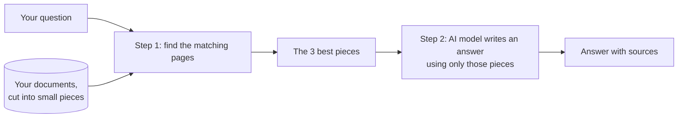

There are many ways to build each part. You can cut the documents into big pieces or small pieces. You can search by matching exact words, by matching meaning, or both. Each choice changes how good the answers are, how fast they come, and how much they cost.

**Nobody can tell in advance which combination is best for *your* documents.** ragpick finds out by testing them all on real questions, grading every answer, and comparing the results fairly.

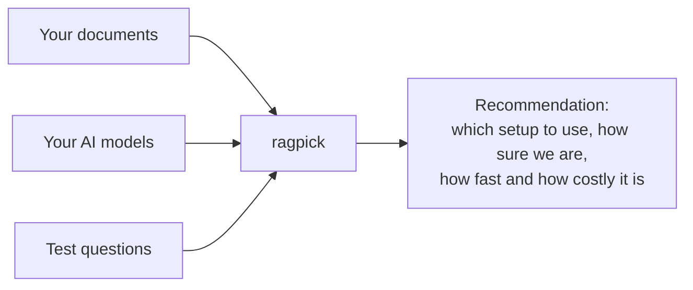

---

## 2. Words you will see

| Word | Simple meaning |
|---|---|
| **Chunk** | A small piece of a document. Documents are cut into chunks so the search can find just the right part. |
| **Chunker** | The rule for cutting. `fixed` cuts every N words. `structure` cuts at the document's own numbered paragraphs (1.1, 1.2, ...). |
| **Retriever** | The search method that finds chunks for a question. |
| **BM25** | Search by matching **words** (like a book index). Good at exact terms such as "RBI/2023-24/53". |
| **Dense** | Search by matching **meaning**, using an embedding model. Finds "keep the paperwork" when the text says "maintain records". |
| **Hybrid** | Both searches together, with their rankings combined. |
| **Embedding model** | An AI model that turns text into numbers, so that texts with similar meaning get similar numbers. |
| **Setup** | One combination, for example "structure chunker + hybrid search". |
| **Superseded** | A rule that has been replaced by a newer rule. Old rules must not be used for answers. |
| **Judge** | An AI model that grades each answer against the correct answer. |
| **Recall@3** | Out of 100 questions, how often was the right chunk among the top 3 search results? |
| **Accuracy** | How many answers were correct. |
| **Faithfulness** | Did the answer only say things that the found chunks actually support (no made-up facts)? |
| **95% range** | The score could be a bit higher or lower with different questions. The true score is very likely inside this range. |
| **Tied** | Two setups are so close that the difference could be luck. |

---

## 3. How ragpick works: the four steps

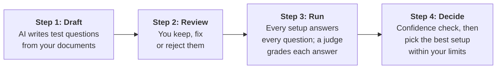

### Step 1. Draft the test questions

To test a system you need questions with known correct answers. Writing 100 of them by hand takes hours, so `ragpick draft` asks an AI model to write them from your documents. It writes a mix of question types:

| Type | Example |
|---|---|
| lookup | "Which documents count as an Officially Valid Document?" |
| numeric | "Within how many days must NBFCs report frauds?" |
| paraphrase | Same fact, asked in everyday words that do not match the document's wording |
| multi_doc | Needs facts from two documents, for example "how did the rule change from 2017 to 2021?" |
| unanswerable | A believable question that the documents do **not** answer. The correct reply is "NOT FOUND". |

Every draft is checked automatically **before** you see it:

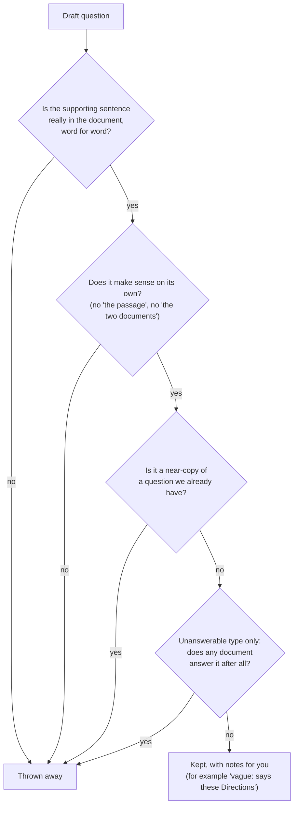

### Step 2. Review

You open `draft_questions.csv` in Excel, set `keep` to `n` for bad rows, fix any wording, and run `ragpick accept`. Only your approved questions enter the test set.

### Step 3. Run

ragpick builds every setup you listed, asks each one every question, and grades every answer.

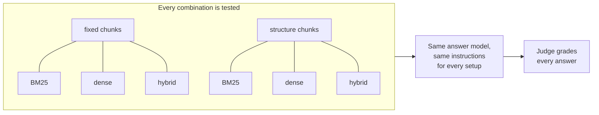

Only the search part changes between setups. The answer model and its instructions stay exactly the same, so any difference in results comes from the search.

### Step 4. Decide

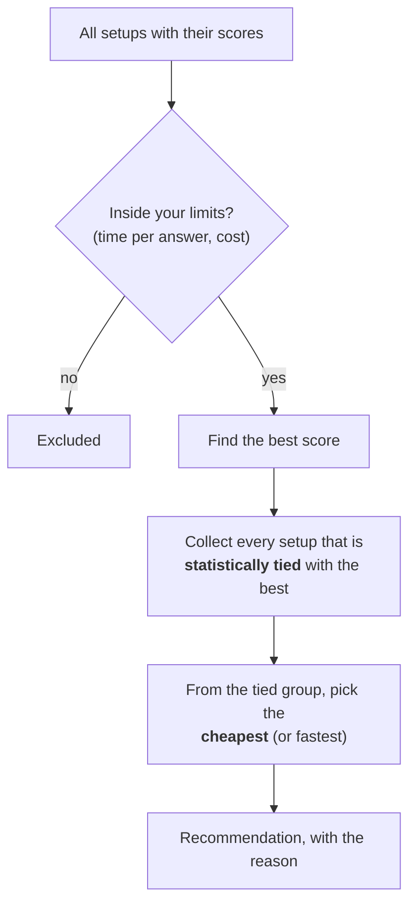

The idea: if two setups are equally good, choose the one that is cheaper and faster. Differences smaller than 10% count as equal, and then the higher score wins.

---

## 4. Architecture: who talks to whom

ragpick is one program that talks to up to three AI models, each with one job.

| Role | Job | Default model |
|---|---|---|
| **Embedding model** | Turns text into numbers for meaning-based search | Azure AI Foundry `text-embedding-3-small` |
| **Answer model** | Writes the answer from the found chunks | Goedel Machines `deepseek/deepseek-v4.1-flash` |
| **Judge model** | Grades each answer: correct? faithful? | Goedel Machines `deepseek/deepseek-v4.1-flash` |
| **Question writer** | Drafts test questions (step 1) | the answer model |

Any of these can be swapped in `config.yaml`: Claude, any OpenAI-compatible server, local sentence-transformers, or your own class.

### Components

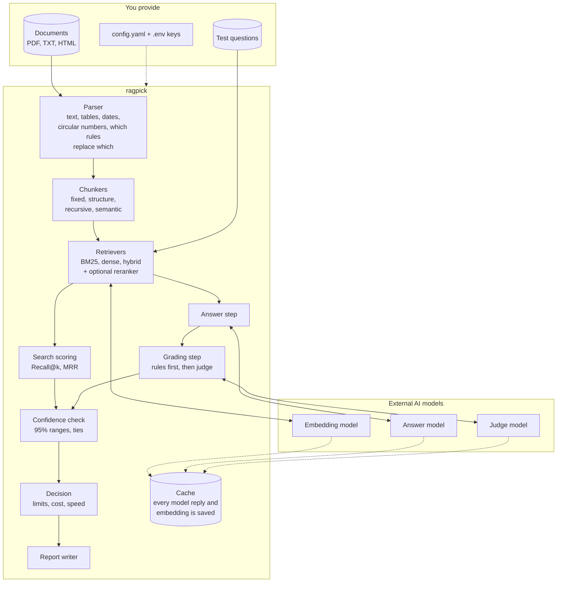

### One question, step by step

This is what happens for a single question in a single setup:

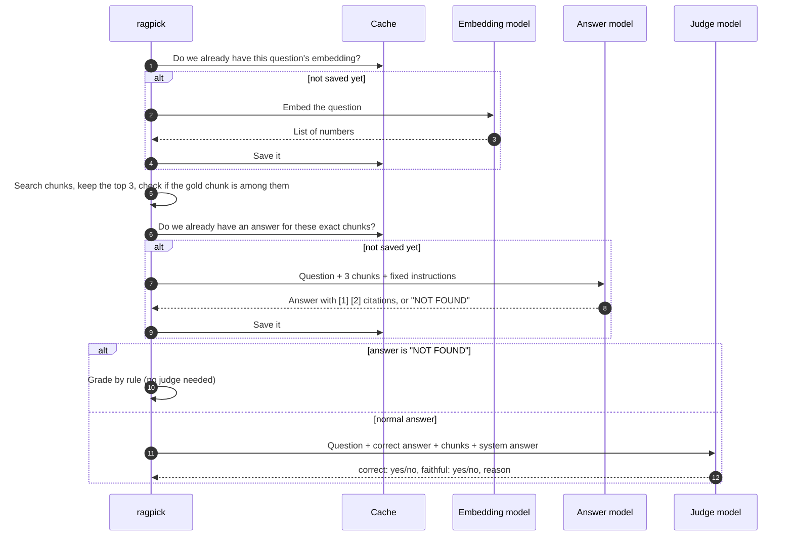

**The cache matters.** Every model reply is saved on disk. Running the same experiment again costs nothing, and adding new setups only pays for the new work.

---

## 5. Setup

### Install

You need Python 3.10 or newer.

```bash
git clone https://github.com/dahiya-04/ragpick-pick-the-right-RAG-.git
cd ragpick-pick-the-right-RAG-
python -m venv .venv
.venv\Scripts\activate            # Windows
# source .venv/bin/activate       # macOS / Linux
pip install -e .
```

Optional extras:

```bash
pip install -e ".[dense]"   # local embedding models and rerankers (sentence-transformers)
pip install -e ".[llm]"     # Claude as answer or judge model
pip install -e ".[dev]"     # tests
```

### Add your keys

Copy `.env.example` to `.env` and fill it in. ragpick finds `.env` in the current folder or any folder above it. The file is never committed.

```bash
AZURE_EMBEDDING_ENDPOINT=https://<your-resource>.openai.azure.com
AZURE_EMBEDDING_API_KEY=<your-key>
GOEDEL_API_KEY=<your-goedel-key>
```

### Check the install, with no keys at all

```bash
ragpick demo
```

This runs a small built-in example with offline stand-in models. It needs no keys and no downloads, and finishes in seconds.

---

## 6. Running it

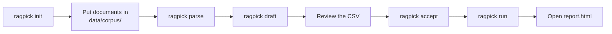

| Command | What it does |
|---|---|
| `ragpick init my-project` | Creates the folders and a starter `config.yaml` |
| `ragpick parse my-project/config.yaml` | Reads the documents only. Check `parse_report.csv` before anything else. |
| `ragpick draft my-project/config.yaml --n 60` | AI drafts 60 test questions into `testset/draft_questions.csv` |
| `ragpick accept my-project/testset/draft_questions.csv` | Adds the rows you kept to `testset/questions.jsonl` |
| `ragpick split my-project/testset/questions.jsonl` | Optional: 30% "dev" questions for tuning, 70% "test" for the final result |
| `ragpick run my-project/config.yaml --dry-run` | Shows what will run and how many model calls it needs. Runs nothing. |
| `ragpick run my-project/config.yaml --limit 3` | Quick trial on the first 3 questions |
| `ragpick run my-project/config.yaml` | The full experiment |
| `ragpick judge-sample results/<run> --n 50` | 50 answers for you to grade by hand (judge labels hidden) |
| `ragpick agreement results/<run>` | How often you and the judge agree |

Any config value can be changed for one run with `--set`, for example `--set decision.prefer=speed`.

### Writing questions by hand

One question per line in `testset/questions.jsonl`:

```json
{"id": "q17", "type": "numeric", "question": "Within how many days must a card closure request be honoured?",
 "answer": "Seven working days.",
 "evidence": [{"text": "Any request for closure of a credit card shall be honoured within seven working days", "doc": "credit_card_master_direction_2022"}]}
```

`evidence` is the **sentence** from the document that holds the answer, not a chunk number. Different chunkers cut documents differently, so ragpick finds the evidence in any chunk by comparing overlapping three-word sequences.

---

## 7. Our experiment: banking circulars

We tested ragpick on documents that look like Reserve Bank of India (RBI) circulars. These are banking rules about cards, loans, KYC and payments.

> **The documents are synthetic.** They are written to look like RBI circulars, but they are **not** real RBI documents, and every page says so. They are in [`examples/rbi-synthetic/`](examples/rbi-synthetic/), so you can repeat the experiment.

### 7.1 The question we asked

> *For rule documents like these, which way of cutting and searching gives the most correct answers? And is the difference real, or just luck?*

What we expected before running:

| Guess | Why we expected it |
|---|---|
| Hybrid search beats meaning-only search | Rule documents are full of exact codes and numbers, which word search handles well |
| Cutting at the document's own paragraphs beats fixed-size cutting | A numbered paragraph is one complete rule. Fixed cuts can split a rule in half. |
| Old (superseded) rules will confuse the system | Old and new rules use almost the same words |

### 7.2 The data

**18 documents.** 3 of them are old rules replaced by newer ones (credit cards 2019, failed transactions 2016, prepaid instruments 2017). ragpick detected all three automatically from sentences like "this circular supersedes ...".

We wrote **36 questions** by hand, made deliberately hard:

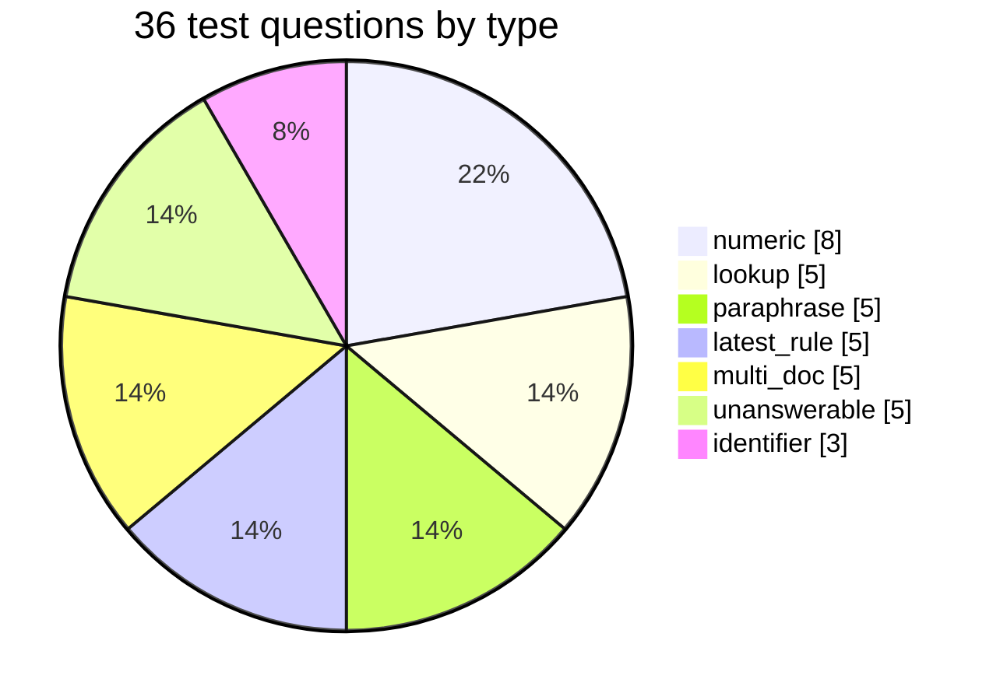

- **latest_rule**: the question has an old and a new answer, and only the new one is correct.
- **identifier**: the question names a circular by its code, for example "DPSS.CO.PD.No.629/02.01.014/2019-20".
- One question contains a trap: a similar rule in a different document gives "ten years" when the right answer is "five years".

### 7.3 The setups we compared

2 ways of cutting x 3 ways of searching = **6 setups**. Each setup answered all 36 questions, giving 216 graded answers.

| | BM25 (words) | Dense (meaning) | Hybrid (both) |
|---|---|---|---|
| **fixed** (120-word pieces) | setup 1 | setup 2 (our starting point) | setup 3 |
| **structure** (by numbered paragraph) | setup 4 | setup 5 | setup 6 |

Models: Azure `text-embedding-3-small` for meaning search. Goedel `deepseek-v4.1-flash` for answers and for grading.

### 7.4 The results

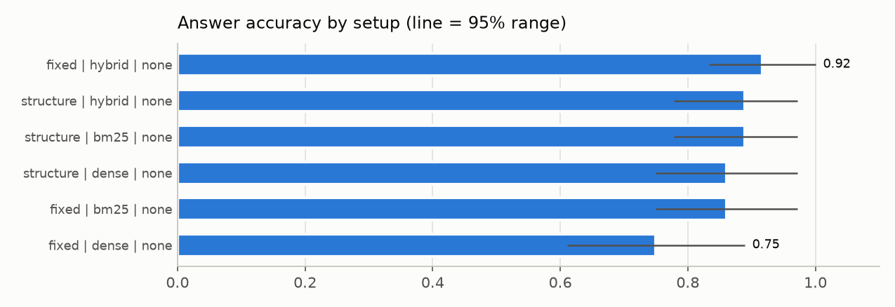

| Setup | Correct answers | 95% range | Found the right chunk in top 3 | Faithful | Tokens per answer | Verdict |
|---|---|---|---|---|---|---|
| fixed + hybrid | **0.92** | 0.83 to 1.00 | 0.92 | 1.00 | 802 | best score |
| structure + hybrid | 0.89 | 0.78 to 0.97 | 0.92 | 1.00 | 511 | tied with best |
| structure + bm25 | 0.89 | 0.78 to 0.97 | 0.90 | 0.97 | 522 | tied with best |
| structure + dense | 0.86 | 0.75 to 0.97 | 0.90 | 0.96 | 508 | tied with best |
| fixed + bm25 | 0.86 | 0.75 to 0.97 | 0.87 | 1.00 | 825 | tied with best |
| fixed + dense (starting point) | 0.75 | 0.61 to 0.89 | 0.73 | 0.96 | 746 | **clearly worse** |

**How to read it:** 0.92 means 92 out of 100 answers were correct. The 95% range shows how much that number could move with a different set of questions.

### 7.5 What we learned

**1. Meaning-only search on fixed pieces was clearly the weakest.** Adding word search (hybrid) raised correct answers from 0.75 to 0.92. The gain is +0.17, with a 95% range of +0.06 to +0.31. The whole range is above zero, so this improvement is real, not luck.

**2. The top five setups are tied.** The best and the second-best gave different results on only **3 of 36** questions. To prove a gap that small, we would need about **860 questions**. So "fixed + hybrid is the single best" is **not** something this data can show, and ragpick says so instead of pretending.

**3. Because they are tied, cost and speed decide.** Cutting by paragraph gives smaller, cleaner pieces, so the answer model reads about **36% fewer tokens** for the same quality:

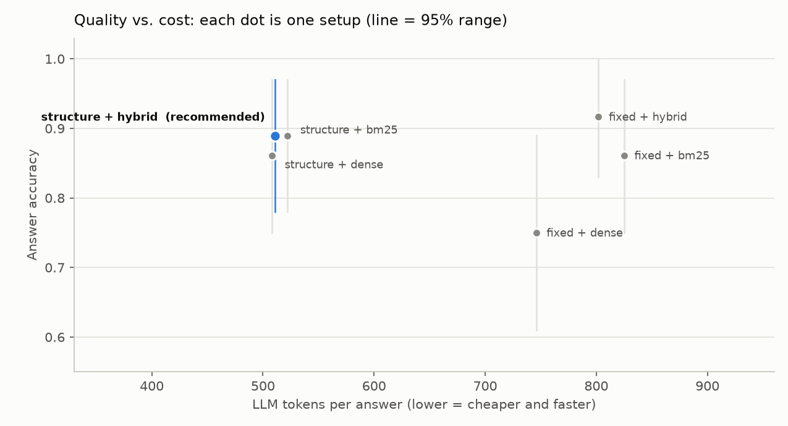

ragpick's recommendation:

> **Use structure + hybrid.** Its accuracy (0.89) is statistically tied with the top score (0.92, fixed + hybrid), and it uses 36% fewer tokens per answer, so it is cheaper and faster.

**4. Different question types have different winners.**

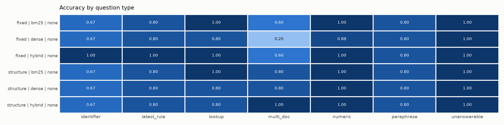

- **Multi-document questions:** cutting by paragraph won clearly (1.00 for structure + hybrid against 0.20 for the starting point). A whole numbered rule fits in one piece, so both rules are found.
- **Identifier questions** ("what does circular DPSS...629 say?"): fixed + hybrid won. The circular code appears only at the top of a document. A large fixed piece keeps the code and the rule together, while paragraph pieces separate them.
- **Paraphrase questions:** every setup scored 0.80. The trap question fooled all six.

**5. Most mistakes come from search, not from writing.** Faithfulness was 0.96 or higher everywhere, so the answer model almost never made things up. When an answer was wrong, it was usually because the right piece was never found. Examples from the best setup:

| Question | What happened | Why |
|---|---|---|
| "How many years must a bank keep records under the 2016 KYC Direction?" | Said "ten years" instead of "five years" | Search found the similar rule from a *different* document (the trap) |
| "Days to pay a credit card bill under the 2019 circular and the 2022 Direction?" | Answered for 2022 only | Found only one of the two needed pieces |
| "How did the minimum validity of prepaid instruments change from 2017 to 2021?" | Said it could not find a change | Found the 2021 notice but not the 2017 rule |

### 7.6 Testing the question drafter

We asked ragpick to draft 20 questions from the same documents. Most were good. Review found four kinds of problems, and each became an automatic check:

| Problem found in review | Example | Fix now built in |
|---|---|---|
| Not standalone | "...compare with the deadline in passage 1" | Questions that mention "passage" or "the two documents" are thrown away |
| Vague | "...under these Directions" (18 documents could match) | Marked VAGUE for the reviewer |
| Unrelated pairing | Comparing board-minute storage with training frequency | Two-document questions must be about the same subject and name both documents |
| Not really unanswerable | A "no answer" question that one document did answer | The search before keeping it now checks 8 pieces instead of 5 |

---

## 8. How ragpick stays honest

**Same conditions for everyone.** Every setup uses the same answer model, the same instructions and the same questions. Only the search changes.

**Rules before the judge.** If the correct reply is "NOT FOUND" and the system said "NOT FOUND", it is graded correct by a simple rule. The AI judge only sees real answers. Faithfulness is judged against the found pieces only, not against the judge's own knowledge.

**Search is scored without the AI.** Recall@k checks whether the known evidence sentence is inside the found pieces. This works for any chunker, because it compares overlapping word sequences, not chunk numbers.

**Confidence, explained with coins.** Suppose setup A beats setup B on 4 questions, and B never beats A. Is A better? If they were really equal, each of those 4 questions would be like a coin flip. Getting 4 out of 4 the same way happens by luck 1 time in 8 (p = 0.125). That is too common to call it proof. So ragpick calls them **tied**. It only says "better" when luck would explain the gap less than 5% of the time.

<details>
<summary>The statistics in detail</summary>

- **95% range for each score:** bootstrap. The question set is re-sampled with replacement 2,000 times, and the middle 95% of the resulting scores is reported.
- **Tie verdict:** a paired sign-flip test on per-question differences against the best setup. It is exact (all sign patterns) when 16 or fewer questions differ, and Monte Carlo (20,000 flips) otherwise. For right/wrong scores this is the exact McNemar test. The bootstrap alone is too eager when only a few questions differ, which is the usual case.
- **Questions needed:** `((1.96 + 0.84) x sd / gap)^2`, the usual sample size for 95% confidence and 80% power.

</details>

**Speed that matches real use.** Question embeddings are cached, which would make meaning-based search look instant. So each run times three live embedding calls and adds that time to every query of the setups that need it.

**Check the judge yourself.** `ragpick judge-sample` gives you 50 answers to grade by hand. `ragpick agreement` reports how often you and the judge agree.

**Every failure gets a likely cause:**

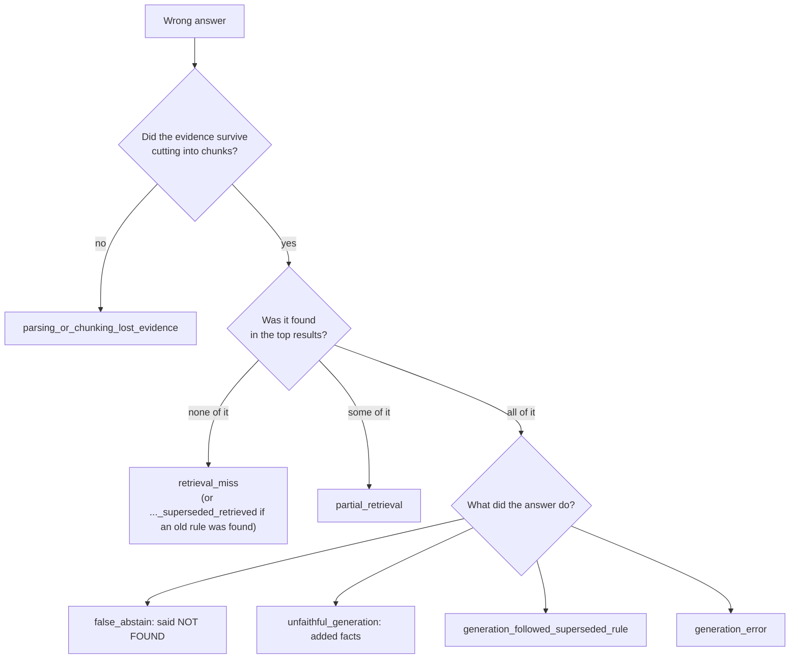

---

## 9. What a run produces

Everything goes to `results/<run_name>_<date-time>/`:

| File | Contents |
|---|---|
| `report.html`, `report.md` | The full report: headline, recommendation, charts, tables, failure examples |
| `summary.csv` | One row per setup with every score, range, verdict, time and cost |
| `by_type.csv` | Every setup's score per question type |
| `failures.csv` | Every wrong answer of the best setup, with its likely cause and an empty column for your own note |
| `parse_report.csv` | Per document: pages, tables, removed headers, circular number, date, replaced-by |
| `evidence_findability.csv` | Whether each evidence sentence still exists after cutting, per chunker |
| `per_question.jsonl` | Every question x setup with all details, for your own analysis |
| `charts/` | Accuracy, Recall@k and question-type charts |

---

## 10. Configuration reference

A short `config.yaml`:

```yaml
run_name: rbi
corpus:
  path: data/corpus
testset:
  path: testset/questions.jsonl
  split: all                     # all | dev | test

embedders:
  azure-small: {type: azure, api: openai, deployment: text-embedding-3-small}

chunkers:
  - {name: fixed, type: fixed, size: 400, overlap: 50}
  - {name: structure, type: structure, max_size: 500, min_size: 40}

retrievers:
  - {name: bm25, type: bm25}
  - {name: dense, type: dense, embedder: azure-small}
  - {name: hybrid, type: hybrid, embedder: azure-small}

evaluation:
  k: [1, 3, 5]
  context_k: 5                   # how many pieces the answer model reads
  baseline: {chunker: fixed, retriever: dense, reranker: none}

generation:
  llm: {type: goedel, model: deepseek/deepseek-v4.1-flash}
judge:
  llm: {type: goedel, model: deepseek/deepseek-v4.1-flash}

decision:
  max_latency_ms: 3000           # optional limit on time per answer
  max_usd_per_1k:                # optional limit on cost per 1,000 answers
  prefer: cost                   # cost | speed

prices:                          # USD per million tokens [input, output]
  deepseek/deepseek-v4.1-flash: [0.10, 0.40]
```

### Available parts

| Part | Options |
|---|---|
| Documents | PDF (with tables), TXT, MD, HTML. Removes repeated headers and footers and Hindi lines. Reads RBI circular numbers, dates and which rules replace which. |
| Chunkers | `fixed`, `recursive`, `structure`, `semantic` |
| Embedders | `azure` (Azure AI Foundry), `sentence-transformers` (local), `hashing` (offline stand-in) |
| Retrievers | `bm25`, `dense`, `hybrid`, plus `superseded_filter: [false, true]` to also test hiding old rules |
| Rerankers | `cross-encoder`, `lexical`, `none` |
| Answer and judge models | `goedel`, `openai-compatible` (any OpenAI-style server), `anthropic` (Claude), `extractive` and `lexical` (offline stand-ins) |

To add your own part, write a class and set `type: my_module:MyClass`.

To save model calls on large grids, `generation.configs: top:4` runs search for every setup but writes answers only for the 4 setups with the best search scores.

---

## 11. Limitations

- **Small question sets give wide ranges.** With 36 questions, a 3-point difference cannot be proven. Use 100 or more questions for decisions that matter. The report tells you roughly how many you need.
- **The judge is an AI model.** It can be wrong. Grade 50 answers by hand with `judge-sample` and check `agreement`. Using a different model for judging than for answering is safer.
- **Drafted questions are easier than real ones.** Add some hard questions by hand: old-versus-new rules, trick wording, codes.
- **The example documents are synthetic.** Real documents bring scanned pages, complex tables and messy layouts. Check `parse_report.csv` first.
- **Speed numbers depend on the network and the provider's load** at the time of the run.
- **Only the search part is compared.** The answer model and its instructions are fixed during a run. To compare answer models, run twice with different `generation.llm` settings.

---

## 12. Project layout

```
ragpick/
  cli.py          commands (init, demo, draft, accept, split, parse, run, judge-sample, agreement)
  parsing.py      read documents, clean text, extract metadata, detect replaced rules
  chunking.py     fixed, recursive, structure, semantic chunkers
  embeddings.py   Azure, sentence-transformers, hashing; embedding caches
  retrieval.py    BM25, dense, hybrid search
  rerank.py       rerankers
  llm.py          model clients (OpenAI-compatible, Claude) with a reply cache
  generation.py   the fixed answer instructions
  judge.py        grading rules and the judge
  metrics.py      Recall@k and MRR with evidence-sentence matching
  stats.py        95% ranges and tie tests
  decide.py       the final recommendation
  drafting.py     question drafting and its checks
  pipeline.py     runs everything in order
  report.py       tables, charts, report.md and report.html
examples/rbi-synthetic/   the experiment in section 7 (synthetic documents + 36 questions)
tests/                    24 offline tests: pytest
docs/images/              charts used in this README
```

---

## License

MIT. See [LICENSE](LICENSE).
