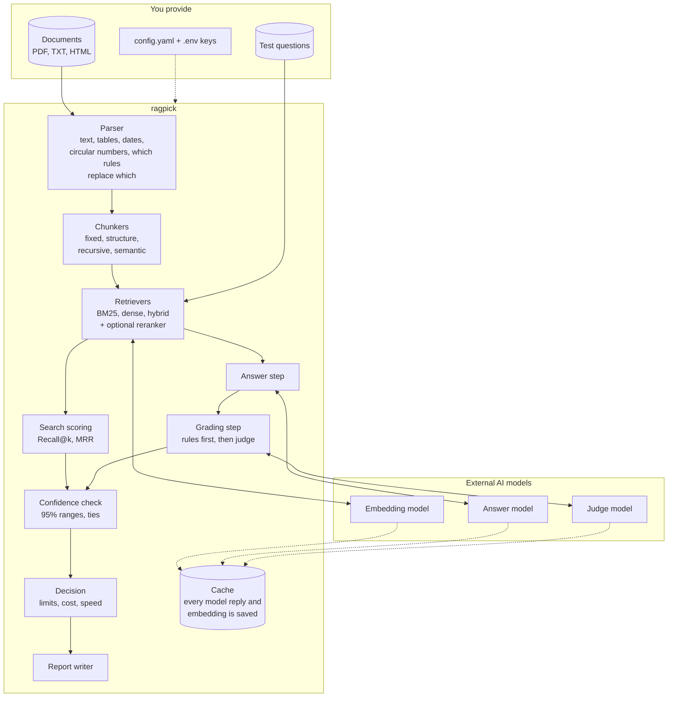
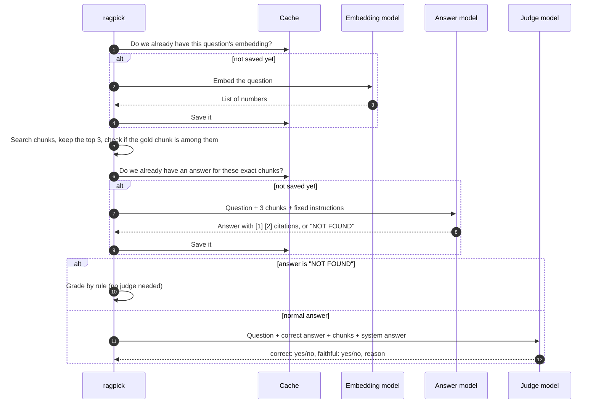

# Architecture: who talks to whom

ragpick is one program that talks to up to three AI models, each with one job.

| Role | Job | Default model |
|---|---|---|
| **Embedding model** | Turns text into numbers for meaning-based search | Azure AI Foundry `text-embedding-3-small` |
| **Answer model** | Writes the answer from the found chunks | Goedel Machines `deepseek/deepseek-v4.1-flash` |
| **Judge model** | Grades each answer: correct? faithful? | Goedel Machines `deepseek/deepseek-v4.1-flash` |
| **Question writer** | Drafts test questions (step 1) | the answer model |

Any of these can be swapped in `config.yaml`: Claude, any OpenAI-compatible server, local sentence-transformers, or your own class.

## Components

## One question, step by step

This is what happens for a single question in a single setup:

**The cache matters.** Every model reply is saved on disk. Running the same experiment again costs nothing, and adding new setups only pays for the new work.
