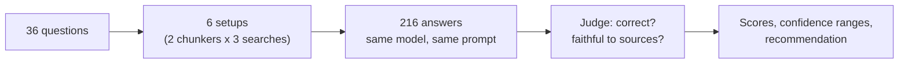
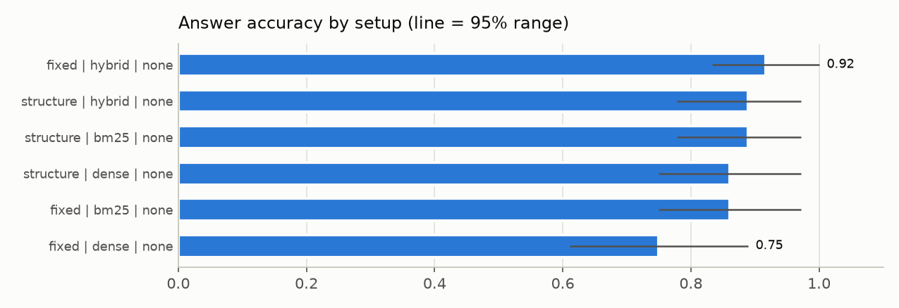
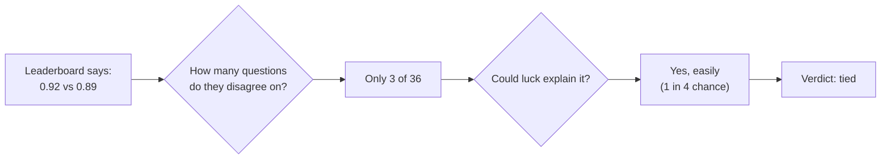
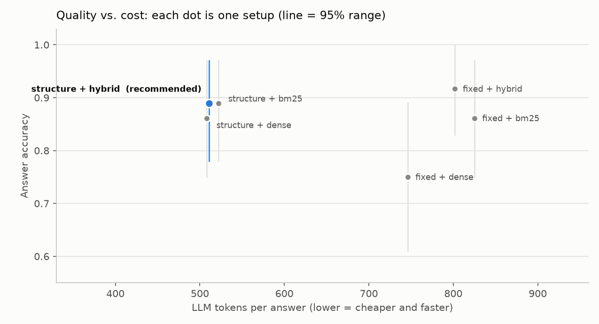
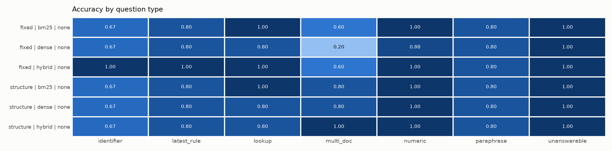

# I tested 6 RAG setups on banking rules. The top 5 were tied.

*And that turned out to be the most useful result of the whole experiment.*

---

Everyone building a RAG system faces the same pile of choices. How big should the chunks be? Should you search by keywords, by meaning, or both? Do you need a reranker?

Most advice online says something like "hybrid search is best" or "use semantic chunking". But your documents are not someone else's documents. So I built a small tool, [ragpick](https://github.com/dahiya-04/ragpick-pick-the-right-RAG-), that tests every combination on *your* data and tells you which one to use.

Then I pointed it at a set of banking regulations. Here is what happened.

## The setup

**The documents.** 18 circulars written to look like Reserve Bank of India rules about credit cards, KYC, loans and payments. They are synthetic, not real RBI documents, but they copy the hard parts of the real thing:

- **Rules that replace older rules.** 3 of the 18 documents are superseded. For example, a 2019 credit card circular says customers get 14 days to pay, and the 2022 Master Direction that replaced it says 15 days. Both are in the collection, and they use almost the same words.
- **Reference codes everywhere,** like `DPSS.CO.PD.No.629/02.01.014/2019-20`.
- **Look-alike rules in different documents.** One document says records are kept for five years and another says ten years, for a different type of bank.

**The questions.** 36 questions, written by hand to be difficult:

| Type | How many | What makes it hard |
|---|---|---|
| numeric | 8 | The exact number must match |
| lookup | 5 | Plain fact finding |
| paraphrase | 5 | Asked in everyday words that do not match the document's wording |
| latest_rule | 5 | Old and new answers both exist; only the new one counts |
| multi_doc | 5 | Needs facts from two documents |
| unanswerable | 5 | The right answer is "NOT FOUND" |
| identifier | 3 | Names a circular only by its reference code |

**The setups.** 2 ways of cutting documents x 3 ways of searching = 6 setups:

- **Cutting:** `fixed` (every 120 words) or `structure` (at the document's own numbered paragraphs: 1.1, 1.2, ...).
- **Searching:** `bm25` (keyword matching), `dense` (meaning matching with Azure `text-embedding-3-small`), or `hybrid` (both, rankings combined).

Every setup used the same answer model (`deepseek-v4.1-flash`) with the same instructions. The model read the top 3 chunks and had to cite them or reply "NOT FOUND". A judge model graded every answer, which made 216 graded answers in total.



## Finding 1: meaning-only search was clearly the weakest



| Setup | Correct answers |
|---|---|
| fixed + hybrid | 0.92 |
| structure + hybrid | 0.89 |
| structure + bm25 | 0.89 |
| structure + dense | 0.86 |
| fixed + bm25 | 0.86 |
| **fixed + dense** | **0.75** |

The popular default, fixed chunks with embedding search, came last. Adding keyword search to it (hybrid) raised correct answers from 0.75 to 0.92.

The reason makes sense once you see the questions. Regulatory text is full of exact tokens: reference codes, paragraph numbers, "T + 5 days", "Rs 10,000". Embeddings blur these. Keyword search catches them exactly.

Is the gain real? The improvement was +0.17, and its 95% range was +0.06 to +0.31. The whole range is above zero, so this one is a real difference, not luck.

## Finding 2: the top five were statistically tied

This is the part I did not expect. The leaderboard says "fixed + hybrid wins with 0.92". But look at how it won.

The winner and the runner-up gave different results on only **3 of the 36 questions**. Everything else was identical.

Here is a simple way to think about it. Suppose two setups are really equally good. On the few questions where they disagree, which one gets it right is basically a coin flip. If A wins all of the disputed questions, how often would pure luck produce that?

- 3 out of 3 the same way happens by luck **1 time in 4**.
- 4 out of 4 happens **1 time in 8**.

Those are not rare events. So a 3-point lead on 36 questions proves nothing. ragpick reports the top five as **tied** and says roughly how many questions you would need to separate the top two: about **860**.



**An honest confession.** My first version of this check used the popular bootstrap method alone. My own unit tests caught it calling a 4-out-of-4 split "significant". The bootstrap is too eager when only a handful of questions differ, which is exactly the normal case in RAG evaluation. I replaced it with an exact sign-flip test (McNemar's test, for right/wrong scores). If you compare RAG setups on small question sets, check how your tool decides that one setup is "better".

## Finding 3: when quality ties, cost decides

If five setups are equally good, the question changes from "which is best?" to "which is cheapest and fastest among the best?"



Here the chunking method matters a lot. Structure chunks are smaller and cleaner, because each one is a single numbered rule. So the answer model reads about **36% fewer tokens** for the same quality: 511 tokens per answer against 802.

ragpick's recommendation:

> **Use structure + hybrid.** Its accuracy (0.89) is statistically tied with the top score (0.92), and it uses 36% fewer tokens per answer.

A plain leaderboard would have pointed me to the more expensive setup, for a lead that may not exist.

## Finding 4: each question type had a different winner



- **Multi-document questions:** structure chunking won by a mile, 1.00 against 0.20 for the fixed + dense baseline. When each chunk is one complete rule, both rules needed for a comparison get found.
- **Identifier questions** ("what does circular DPSS...629 say?"): fixed chunks won. The reference code appears only at the top of a document. A large fixed chunk keeps the code and the rule together, while paragraph chunks separate them.
- **Paraphrase questions:** all six setups scored exactly 0.80, because one trap question fooled every one of them.

So "the best setup" depends on what your users actually ask. If most of your traffic is "what does circular X say?", the ranking changes.

## Finding 5: almost every mistake was a search mistake

Faithfulness, meaning the answer only says what the retrieved chunks support, was 0.96 or higher for every setup. The answer model almost never invented things.

When an answer was wrong, the right chunk usually had not been found. Look at the trap question:

> **Q:** For how many years does a bank have to hold on to the paperwork of its customers' dealings under the 2016 KYC Direction?
> **Correct:** five years.
> **System:** "ten years".

The model faithfully reported what it was given. The search simply handed it the similar rule from a *different* document, one written for co-operative banks. Every setup fell for it.

The lesson: if your RAG answers are wrong, look at retrieval before you blame the LLM or rewrite the prompt.

## Two smaller lessons from building the tool

**Your evaluation tooling can fail quietly.** In the first full run, 37 of the 216 judge replies were broken JSON: the model copied the schema description instead of filling it in. Those answers silently counted as "not graded". Fixing the prompt and adding a fallback parser recovered all of them. Check how many answers your judge actually graded.

**AI-drafted test questions need checking.** Writing questions by hand is slow, so ragpick can draft them from your documents. Of 20 drafts, a few said things like "in passage 1" (meaningless to a real user) or "under these Directions" (18 documents could match). Each problem became an automatic filter, but a human review step is still part of the process.

## What I would tell someone building RAG on their own documents

1. **Do not trust a single leaderboard number.** Ask how many questions the top two actually disagree on.
2. **Test with your own hard questions.** Old-versus-new rules, look-alike documents and reference codes broke setups that look fine on easy questions.
3. **Keyword search still matters.** For text full of codes and numbers, pure embedding search was the weakest option.
4. **When quality ties, pick on cost and speed.** Here that meant 36% fewer tokens for free.
5. **Debug retrieval first.** The answer model was rarely the problem.

## Limits of this experiment

- **The documents are synthetic.** Real circulars bring scanned pages, complex tables and messy layouts.
- **36 questions is small.** That is exactly why most setups came out tied. A real decision needs 100 or more.
- **The same model answered and judged.** A different judge model, plus a human check of 50 answers, would make the grades more trustworthy. ragpick supports both; I have not done them yet.

## Try it yourself

The code, the synthetic documents and all 36 questions are open source:

- **Code:** [github.com/dahiya-04/ragpick-pick-the-right-RAG-](https://github.com/dahiya-04/ragpick-pick-the-right-RAG-)
- **Docs:** [How it works](how-it-works.md) and [the full experiment](experiment.md)

```bash
pip install -e .
ragpick demo                                  # offline, no keys needed
ragpick run examples/rbi-synthetic/config.yaml
```

Bring your own documents and models, and let the data pick your RAG setup, including telling you when it can't.
