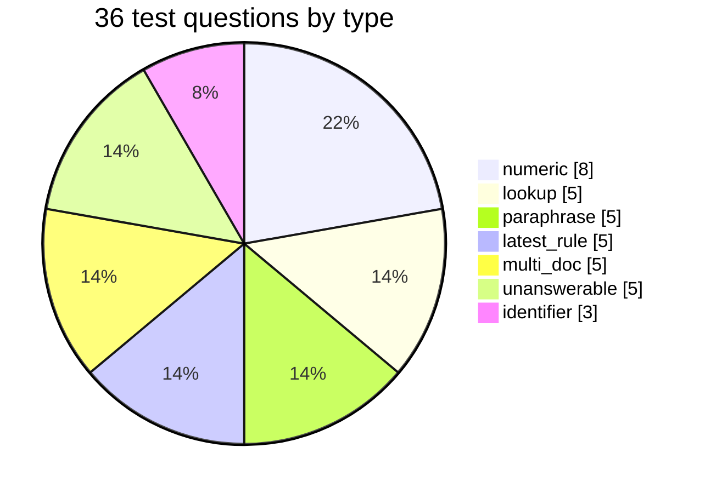
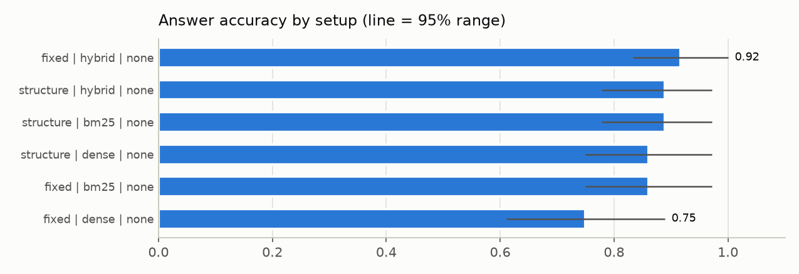
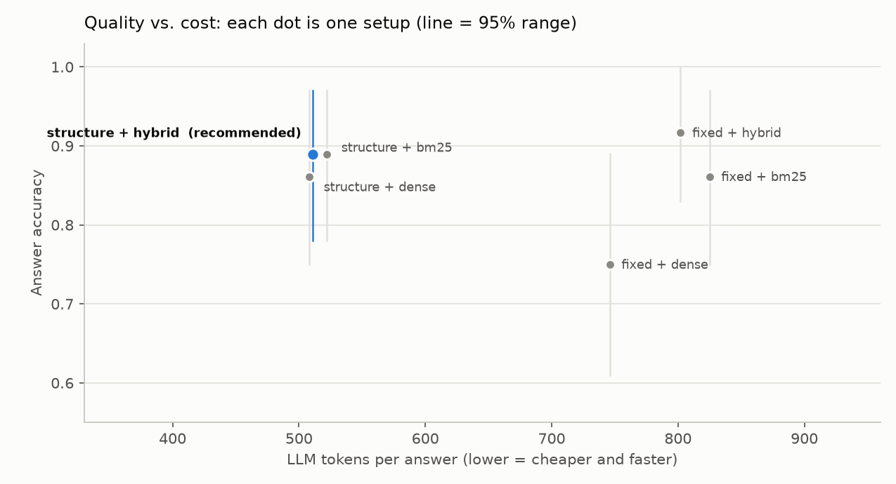
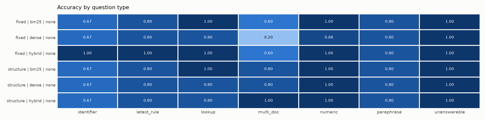

# Our experiment: banking circulars

We tested ragpick on documents that look like Reserve Bank of India (RBI) circulars. These are banking rules about cards, loans, KYC and payments.

> **The documents are synthetic.** They are written to look like RBI circulars, but they are **not** real RBI documents, and every page says so. They are in [`examples/rbi-synthetic/`](https://github.com/dahiya-04/ragpick-pick-the-right-RAG-/tree/main/examples/rbi-synthetic), so you can repeat the experiment.

## The question we asked

> *For rule documents like these, which way of cutting and searching gives the most correct answers? And is the difference real, or just luck?*

What we expected before running:

| Guess | Why we expected it |
|---|---|
| Hybrid search beats meaning-only search | Rule documents are full of exact codes and numbers, which word search handles well |
| Cutting at the document's own paragraphs beats fixed-size cutting | A numbered paragraph is one complete rule. Fixed cuts can split a rule in half. |
| Old (superseded) rules will confuse the system | Old and new rules use almost the same words |

## The data

**18 documents.** 3 of them are old rules replaced by newer ones (credit cards 2019, failed transactions 2016, prepaid instruments 2017). ragpick detected all three automatically from sentences like "this circular supersedes ...".

We wrote **36 questions** by hand, made deliberately hard:

- **latest_rule**: the question has an old and a new answer, and only the new one is correct.
- **identifier**: the question names a circular by its code, for example "DPSS.CO.PD.No.629/02.01.014/2019-20".
- One question contains a trap: a similar rule in a different document gives "ten years" when the right answer is "five years".

## The setups we compared

2 ways of cutting x 3 ways of searching = **6 setups**. Each setup answered all 36 questions, giving 216 graded answers.

| | BM25 (words) | Dense (meaning) | Hybrid (both) |
|---|---|---|---|
| **fixed** (120-word pieces) | setup 1 | setup 2 (our starting point) | setup 3 |
| **structure** (by numbered paragraph) | setup 4 | setup 5 | setup 6 |

Models: Azure `text-embedding-3-small` for meaning search. Goedel `deepseek-v4.1-flash` for answers and for grading.

## The results

| Setup | Correct answers | 95% range | Found the right chunk in top 3 | Faithful | Tokens per answer | Verdict |
|---|---|---|---|---|---|---|
| fixed + hybrid | **0.92** | 0.83 to 1.00 | 0.92 | 1.00 | 802 | best score |
| structure + hybrid | 0.89 | 0.78 to 0.97 | 0.92 | 1.00 | 511 | tied with best |
| structure + bm25 | 0.89 | 0.78 to 0.97 | 0.90 | 0.97 | 522 | tied with best |
| structure + dense | 0.86 | 0.75 to 0.97 | 0.90 | 0.96 | 508 | tied with best |
| fixed + bm25 | 0.86 | 0.75 to 0.97 | 0.87 | 1.00 | 825 | tied with best |
| fixed + dense (starting point) | 0.75 | 0.61 to 0.89 | 0.73 | 0.96 | 746 | **clearly worse** |

**How to read it:** 0.92 means 92 out of 100 answers were correct. The 95% range shows how much that number could move with a different set of questions.

## What we learned

**1. Meaning-only search on fixed pieces was clearly the weakest.** Adding word search (hybrid) raised correct answers from 0.75 to 0.92. The gain is +0.17, with a 95% range of +0.06 to +0.31. The whole range is above zero, so this improvement is real, not luck.

**2. The top five setups are tied.** The best and the second-best gave different results on only **3 of 36** questions. To prove a gap that small, we would need about **860 questions**. So "fixed + hybrid is the single best" is **not** something this data can show, and ragpick says so instead of pretending.

**3. Because they are tied, cost and speed decide.** Cutting by paragraph gives smaller, cleaner pieces, so the answer model reads about **36% fewer tokens** for the same quality:

ragpick's recommendation:

> **Use structure + hybrid.** Its accuracy (0.89) is statistically tied with the top score (0.92, fixed + hybrid), and it uses 36% fewer tokens per answer, so it is cheaper and faster.

**4. Different question types have different winners.**

- **Multi-document questions:** cutting by paragraph won clearly (1.00 for structure + hybrid against 0.20 for the starting point). A whole numbered rule fits in one piece, so both rules are found.
- **Identifier questions** ("what does circular DPSS...629 say?"): fixed + hybrid won. The circular code appears only at the top of a document. A large fixed piece keeps the code and the rule together, while paragraph pieces separate them.
- **Paraphrase questions:** every setup scored 0.80. The trap question fooled all six.

**5. Most mistakes come from search, not from writing.** Faithfulness was 0.96 or higher everywhere, so the answer model almost never made things up. When an answer was wrong, it was usually because the right piece was never found. Examples from the best setup:

| Question | What happened | Why |
|---|---|---|
| "How many years must a bank keep records under the 2016 KYC Direction?" | Said "ten years" instead of "five years" | Search found the similar rule from a *different* document (the trap) |
| "Days to pay a credit card bill under the 2019 circular and the 2022 Direction?" | Answered for 2022 only | Found only one of the two needed pieces |
| "How did the minimum validity of prepaid instruments change from 2017 to 2021?" | Said it could not find a change | Found the 2021 notice but not the 2017 rule |

## Testing the question drafter

We asked ragpick to draft 20 questions from the same documents. Most were good. Review found four kinds of problems, and each became an automatic check:

| Problem found in review | Example | Fix now built in |
|---|---|---|
| Not standalone | "...compare with the deadline in passage 1" | Questions that mention "passage" or "the two documents" are thrown away |
| Vague | "...under these Directions" (18 documents could match) | Marked VAGUE for the reviewer |
| Unrelated pairing | Comparing board-minute storage with training frequency | Two-document questions must be about the same subject and name both documents |
| Not really unanswerable | A "no answer" question that one document did answer | The search before keeping it now checks 8 pieces instead of 5 |
