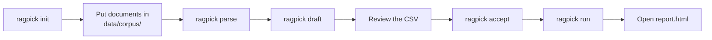

# Setup and running

## Setup

### Install

You need Python 3.10 or newer.

```bash
git clone https://github.com/dahiya-04/ragpick-pick-the-right-RAG-.git
cd ragpick-pick-the-right-RAG-
python -m venv .venv
.venv\Scripts\activate            # Windows
# source .venv/bin/activate       # macOS / Linux
pip install -e .
```

Optional extras:

```bash
pip install -e ".[dense]"   # local embedding models and rerankers (sentence-transformers)
pip install -e ".[llm]"     # Claude as answer or judge model
pip install -e ".[dev]"     # tests
```

### Add your keys

Copy `.env.example` to `.env` and fill it in. ragpick finds `.env` in the current folder or any folder above it. The file is never committed.

```bash
AZURE_EMBEDDING_ENDPOINT=https://<your-resource>.openai.azure.com
AZURE_EMBEDDING_API_KEY=<your-key>
GOEDEL_API_KEY=<your-goedel-key>
```

### Check the install, with no keys at all

```bash
ragpick demo
```

This runs a small built-in example with offline stand-in models. It needs no keys and no downloads, and finishes in seconds.

## Running it



| Command | What it does |
|---|---|
| `ragpick init my-project` | Creates the folders and a starter `config.yaml` |
| `ragpick parse my-project/config.yaml` | Reads the documents only. Check `parse_report.csv` before anything else. |
| `ragpick draft my-project/config.yaml --n 60` | AI drafts 60 test questions into `testset/draft_questions.csv` |
| `ragpick accept my-project/testset/draft_questions.csv` | Adds the rows you kept to `testset/questions.jsonl` |
| `ragpick split my-project/testset/questions.jsonl` | Optional: 30% "dev" questions for tuning, 70% "test" for the final result |
| `ragpick run my-project/config.yaml --dry-run` | Shows what will run and how many model calls it needs. Runs nothing. |
| `ragpick run my-project/config.yaml --limit 3` | Quick trial on the first 3 questions |
| `ragpick run my-project/config.yaml` | The full experiment |
| `ragpick judge-sample results/<run> --n 50` | 50 answers for you to grade by hand (judge labels hidden) |
| `ragpick agreement results/<run>` | How often you and the judge agree |

Any config value can be changed for one run with `--set`, for example `--set decision.prefer=speed`.

### Writing questions by hand

One question per line in `testset/questions.jsonl`:

```json
{"id": "q17", "type": "numeric", "question": "Within how many days must a card closure request be honoured?",
 "answer": "Seven working days.",
 "evidence": [{"text": "Any request for closure of a credit card shall be honoured within seven working days", "doc": "credit_card_master_direction_2022"}]}
```

`evidence` is the **sentence** from the document that holds the answer, not a chunk number. Different chunkers cut documents differently, so ragpick finds the evidence in any chunk by comparing overlapping three-word sequences.
