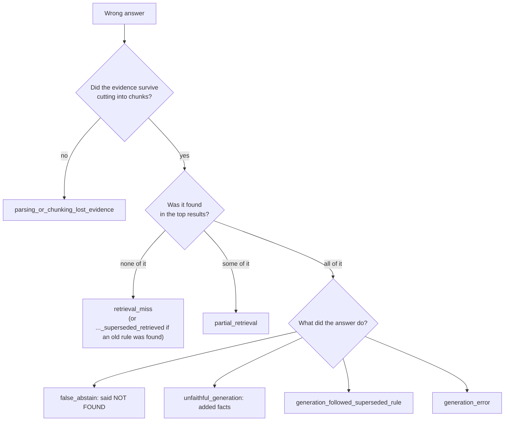

# How ragpick stays honest

**Same conditions for everyone.** Every setup uses the same answer model, the same instructions and the same questions. Only the search changes.

**Rules before the judge.** If the correct reply is "NOT FOUND" and the system said "NOT FOUND", it is graded correct by a simple rule. The AI judge only sees real answers. Faithfulness is judged against the found pieces only, not against the judge's own knowledge.

**Search is scored without the AI.** Recall@k checks whether the known evidence sentence is inside the found pieces. This works for any chunker, because it compares overlapping word sequences, not chunk numbers.

**Confidence, explained with coins.** Suppose setup A beats setup B on 4 questions, and B never beats A. Is A better? If they were really equal, each of those 4 questions would be like a coin flip. Getting 4 out of 4 the same way happens by luck 1 time in 8 (p = 0.125). That is too common to call it proof. So ragpick calls them **tied**. It only says "better" when luck would explain the gap less than 5% of the time.

??? note "The statistics in detail"

    - **95% range for each score:** bootstrap. The question set is re-sampled with replacement 2,000 times, and the middle 95% of the resulting scores is reported.
    - **Tie verdict:** a paired sign-flip test on per-question differences against the best setup. It is exact (all sign patterns) when 16 or fewer questions differ, and Monte Carlo (20,000 flips) otherwise. For right/wrong scores this is the exact McNemar test. The bootstrap alone is too eager when only a few questions differ, which is the usual case.
    - **Questions needed:** `((1.96 + 0.84) x sd / gap)^2`, the usual sample size for 95% confidence and 80% power.

**Speed that matches real use.** Question embeddings are cached, which would make meaning-based search look instant. So each run times three live embedding calls and adds that time to every query of the setups that need it.

**Check the judge yourself.** `ragpick judge-sample` gives you 50 answers to grade by hand. `ragpick agreement` reports how often you and the judge agree.

**Every failure gets a likely cause:**

