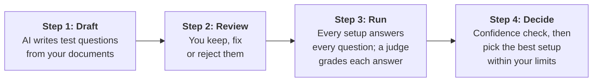
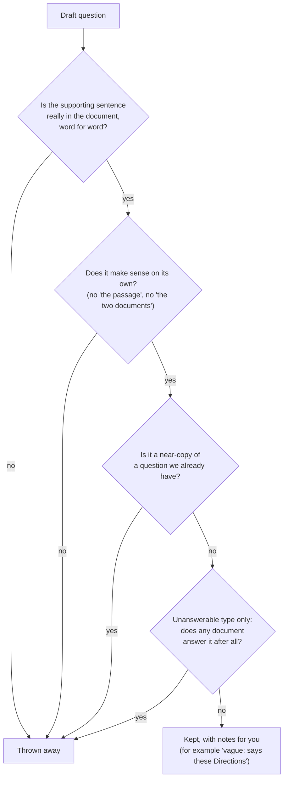
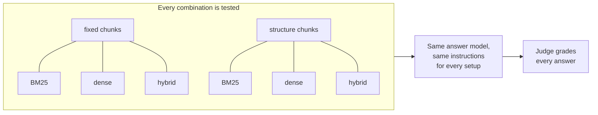
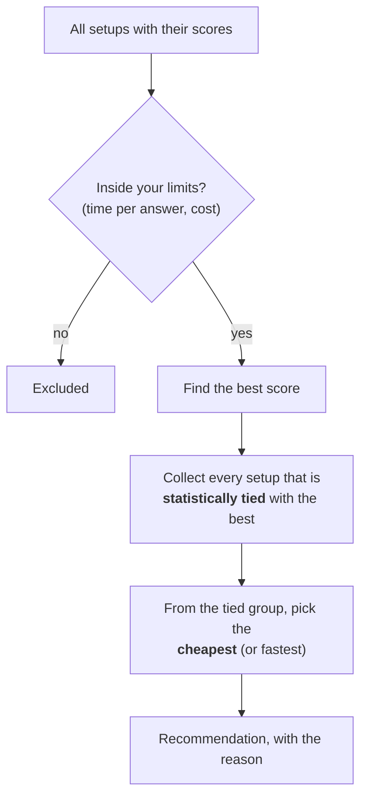

# How ragpick works: the four steps

## Step 1: Draft the test questions

To test a system you need questions with known correct answers. Writing 100 of them by hand takes hours, so `ragpick draft` asks an AI model to write them from your documents. It writes a mix of question types:

| Type | Example |
|---|---|
| lookup | "Which documents count as an Officially Valid Document?" |
| numeric | "Within how many days must NBFCs report frauds?" |
| paraphrase | Same fact, asked in everyday words that do not match the document's wording |
| multi_doc | Needs facts from two documents, for example "how did the rule change from 2017 to 2021?" |
| unanswerable | A believable question that the documents do **not** answer. The correct reply is "NOT FOUND". |

Every draft is checked automatically **before** you see it:

## Step 2: Review

You open `draft_questions.csv` in Excel, set `keep` to `n` for bad rows, fix any wording, and run `ragpick accept`. Only your approved questions enter the test set.

## Step 3: Run

ragpick builds every setup you listed, asks each one every question, and grades every answer.

Only the search part changes between setups. The answer model and its instructions stay exactly the same, so any difference in results comes from the search.

## Step 4: Decide

The idea: if two setups are equally good, choose the one that is cheaper and faster. Differences smaller than 10% count as equal, and then the higher score wins.
