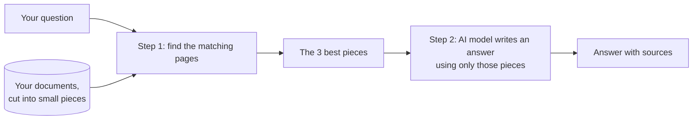
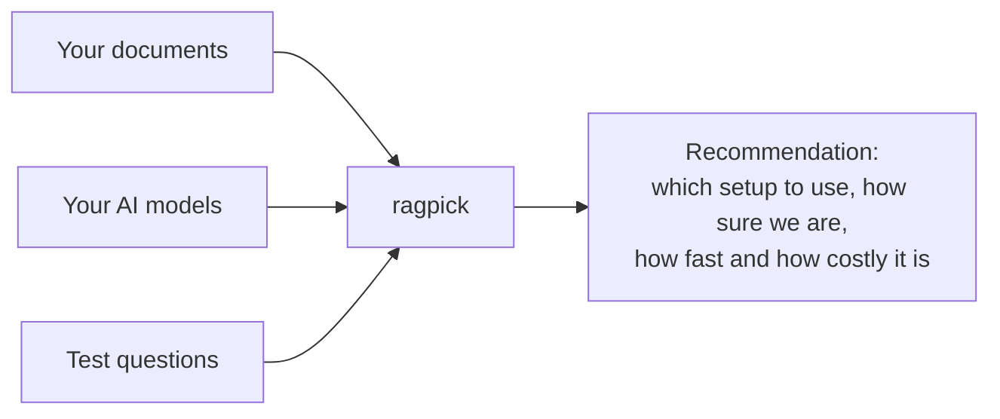

# ragpick

**Bring your documents and your AI models. ragpick tests many ways of building a question-answering system on them, and tells you which way works best, how sure it is, and what it costs.**

```bash
ragpick run config.yaml
```

## The idea in one minute

Imagine a very large library and a helper who answers your questions about it. The helper cannot read every book for every question. So the helper does two things:

1. **Finds** the few pages that seem to match your question.
2. **Writes** an answer using only those pages.

This is called **RAG** (Retrieval-Augmented Generation): *retrieve* the right pages, then *generate* an answer from them.



There are many ways to build each part. You can cut the documents into big pieces or small pieces. You can search by matching exact words, by matching meaning, or both. Each choice changes how good the answers are, how fast they come, and how much they cost.

**Nobody can tell in advance which combination is best for *your* documents.** ragpick finds out by testing them all on real questions, grading every answer, and comparing the results fairly.



## Where to go next

| If you want to... | Read |
|---|---|
| Learn the words first | [Words you will see](glossary.md) |
| Understand the method | [How it works](how-it-works.md) |
| See which parts talk to which | [Architecture](architecture.md) |
| Install and run it | [Setup and running](getting-started.md) |
| See real results | [Our experiment](experiment.md) |
| Read the code | [GitHub repository](https://github.com/dahiya-04/ragpick-pick-the-right-RAG-) |
